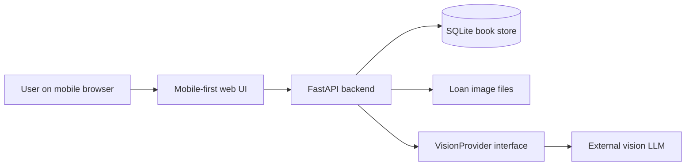
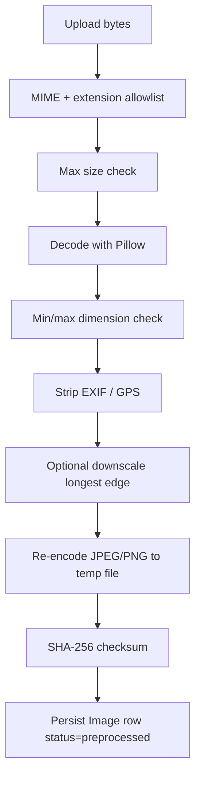
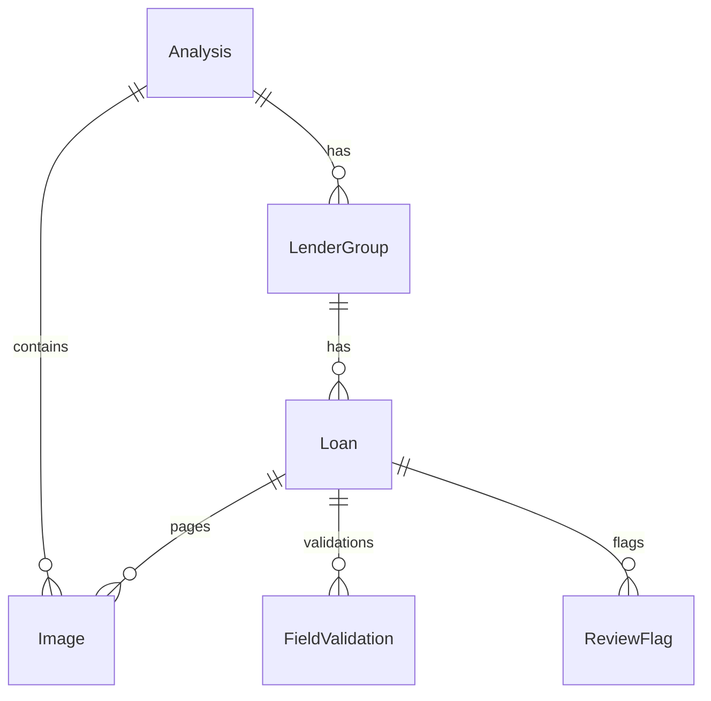
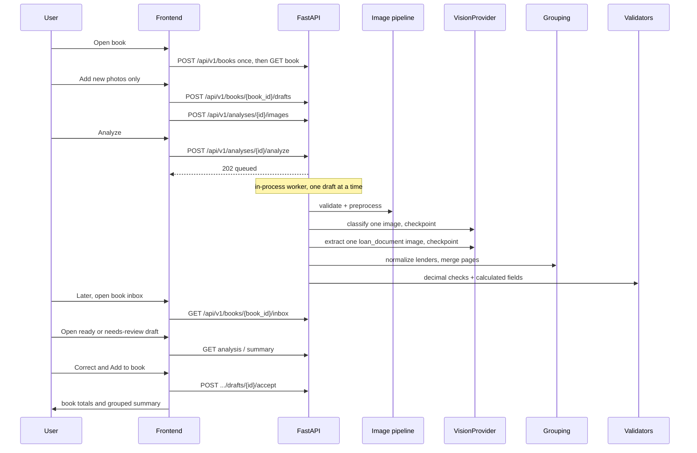
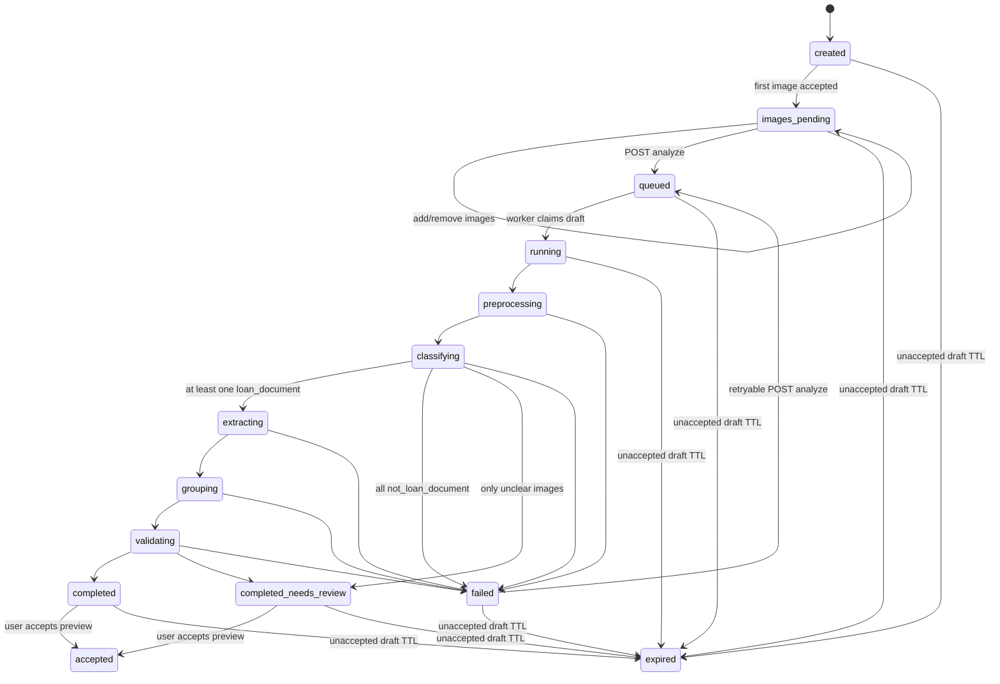

# Loan Lens AI — Architecture & Design Specification

**Repository:** `loanlens-ai`  
**Application:** Loan Lens AI  
**Version:** V1 + V1.1 (draft inbox)  
**Status:** Source of truth for architecture and design  
**Companion:** `documents/LOAN-LENS-DEV-CHECKLIST.md` (implementation plan)

This document is the architecture source of truth. Implementation follows `LOAN-LENS-DEV-CHECKLIST.md` one session at a time. Do not implement functionality described only in the Future Roadmap. V1.1 is in scope once Phase 16 sessions exist in the checklist.

---

## 1. Purpose & Design Principles

### 1.1 Purpose

Loan Lens AI is a **mobile-first** loan book for one phone. The user uploads photos or screenshots of loan agreements. A vision-capable LLM proposes the lender, the amounts, and which pages belong to which loan. The user reviews that preview, corrects anything wrong, and only then the loan joins the book. The book **stays on this phone** until the user removes a loan. The application **normalizes** different lender formats, **groups loans by lender**, **validates amounts in application code**, and shows totals plus a **human-readable summary** of what was received, what must be repaid, and the extra cost.

### 1.2 Design principles

| ID | Principle |
|----|-----------|
| P1 | Never silently invent missing financial or personal values. Unknown stays unknown. |
| P2 | Separate **extracted** values, **calculated** values, and **validation** results. |
| P3 | Deterministic money, date, and consistency checks live in application code, not in the LLM. |
| P4 | The vision/LLM provider is behind an interface and is replaceable. |
| P5 | One backend process + a mobile-first web client. No microservices, RAG, vector DBs, embeddings, Kafka, Temporal, Celery, or multi-agent systems. V1.1 may run **one in-process worker** in that same process. |
| P6 | Treat images and extracted fields as sensitive. Redact logs, never expose secrets. Keep accepted loan screenshots until the user deletes that loan. Delete unaccepted drafts on TTL. |
| P7 | One lender may have many loans. One loan may have one or many pages/screenshots. The user uploads only the new pages when adding a loan. |
| P8 | Prefer a review flag over a guessed number. The user may correct a wrong value; the correction is stored and is not treated as a model extraction. |
| P9 | Architecture may grow later; V1 must not include unused infrastructure. |
| P10 | Spec and checklist control scope. Unlisted product behavior is out of V1. |

### 1.3 Non-goals (V1)

- User accounts, OAuth, or the same book on another phone
- RAG / embeddings / vector search over documents
- Fine-tuning or retraining a vision model from corrections
- A cloud archive or a list of every book on the server
- Credit scoring, underwriting, or loan recommendations
- Payment, disbursement, or lender APIs
- Multi-agent orchestration
- Background job platforms (Celery/Kafka/Temporal/Redis queues)
- Native iOS/Android apps (V1 is a mobile-first web app)
- A global list of every draft on the server (inbox is **per book** only)

---

## 2. System Context

### 2.1 Actors

| Actor | Role |
|-------|------|
| User | Person on this phone who keeps a loan book, uploads new agreement screenshots, reviews the preview, and reads totals |
| Operator | Person who deploys the app and configures `VISION_API_KEY` (not an in-app role in V1) |
| Vision provider | External vision-capable LLM reached only through `VisionProvider` |

### 2.2 Context diagram



### 2.3 Trust boundary

- The browser sends images only to this backend.
- The backend may send **image bytes plus a constrained prompt** to the configured vision provider.
- The backend never sends API keys to the browser.
- Logs must not contain image bytes, full document text dumps, borrower identifiers, or loan IDs in the default configuration.

---

## 3. V1 Scope

V1 includes:

1. One book on this phone, reopened days later, with no login.
2. Upload only the new screenshot or screenshots when adding a loan. One loan may be one page or several.
3. Image validation and preprocessing.
4. Vision LLM document analysis behind `VisionProvider`.
5. A preview of the proposed lender, amounts, and which screenshots belong to which loan. Nothing joins the book until the user accepts the preview.
6. User correction of a wrong amount, date, lender, or page grouping. The corrected value is stored as `user_corrected`.
7. Same-lender correction hints on the next upload. Hints do not apply to other lenders and do not retrain a model.
8. Structured extraction into a shared schema.
9. Lender identification (brand + legal lending entity when present).
10. Grouping: pages → loans → lenders, as a proposal the user can correct before accept.
11. Financial field normalization (money, dates, rates, tenure).
12. Deterministic financial validation in application code.
13. Extra cost in rupees and as a percentage of the amount received.
14. Book totals: received, still to pay, and extra. A loan stays in the list and in the totals until the user removes that loan.
15. Confidence and review handling for uncertain fields.
16. Mobile book: grouped summary, per-loan detail, and the original screenshot behind a button.
17. Accepted loan screenshots kept until that loan is deleted. Unaccepted drafts expire after `LOANLENS_ANALYSIS_TTL_HOURS` (default 24).

V1 explicitly excludes the non-goals in §1.3 and all Future Roadmap items in §24 except as reserved extension points.

### 3.1 V1.1 — Draft inbox (promoted from live testing)

V1.1 does **not** replace the book, preview, or accept rules. It changes **when** Analyze finishes so a slow vision model (Gemini free tier, Ollama) does not block the phone or time out the HTTP request.

V1.1 includes:

1. **Enqueue, do not wait.** `POST .../analyze` stores the draft as `queued` and returns immediately (`202`). The book is still unchanged.
2. **One in-process worker** in the FastAPI process. It runs **one draft at a time**, FIFO by `queued_at`. No Kafka, Temporal, Celery, or Redis.
3. **Leave and return.** The user may close the app. Later they open the same book and see an inbox on that book only.
4. **Evening review pile.** Inbox buckets: **Queued**, **Running**, **Ready to add**, **Needs review**, **Failed**. Counts are shown. Amounts are not shown on the inbox list.
5. **Accept stays manual.** The worker never copies loans into the book. The user still opens a ready/needs-review draft and taps **Add to book**.
6. **Per-image checkpoints.** Classify and extract run **one image per vision call**. Progress (`pages_done` / `pages_total`) is saved after each image. A later timeout does not discard finished pages.
7. **Retry without re-upload.** A `failed` retryable draft keeps its images. Inbox **Retry** re-queues from the first unfinished image (or from `preprocessing` if none are usable).
8. **No write transaction during vision.** SQLite is not held open while waiting on the model (fixes the live-testing lock when another request hits the same DB).

V1.1 excludes: push notifications, a second worker process, a global dashboard of all books, and auto-accept.

---

## 4. User Journey

### 4.1 Happy path

1. User opens the app on this phone and sees the existing book. The first visit creates a book and stores `book_id` in `localStorage`.
2. User taps **Add photos** and selects or captures only the new screenshot or screenshots. Loans already in the book are not uploaded again.
3. UI shows thumbnails; user may add or remove images before analyze.
4. User taps **Analyze**. The draft becomes `queued`. The phone does **not** wait for the model. The user may add more photos (another draft) or close the app.
5. A single in-process worker later runs `preprocessing` → per-image `classifying` / `extracting` → `grouping` → `validating`.
6. The book home shows inbox counts. When the user is ready (later the same day is fine), they open **Ready to add** or **Needs review**.
7. UI shows a **preview**: proposed lender and amounts, and which screenshots were grouped into each loan. The book is unchanged until accept.
8. User corrects a wrong amount, date, lender, or page grouping, then taps **Add to book**.
9. The book shows totals and the summary grouped by lender, in the compact style below.
10. User taps a loan line for extracted vs calculated vs validation details. A button reveals that loan’s screenshot for audit. The screenshot is hidden until the button is tapped.
11. User may **Remove loan**. That loan leaves the list and the totals. Its screenshots are deleted. Other loans stay.

### 4.2 Compact summary format (display contract)

Above the groups, the book shows three totals, summing only accepted loans where that input is non-null:

- **Received** — sum of `disbursed_amount`
- **Still to pay** — sum of `repayment_amount`
- **Extra** — sum of `implied_cost`

If any accepted loan is missing an input for a total, that total is still the sum of the known loans and the UI states that some loans are missing amounts. Missing loans are not treated as zero.

Group header: `{lender_brand}` optionally followed by `({legal_lending_entity})` when known.

Each loan line:

```
{sanctioned_short}, got {disbursed_short}[ on {disbursement_date_short}], pay {repayment_short}[ on {repayment_date_short}][, extra {extra_rupees_short} ({extra_percent}%)]
```

`extra_rupees` is `implied_cost` (`repayment_amount - disbursed_amount`). `extra_percent` is `(repayment_amount - disbursed_amount) / disbursed_amount × 100`, shown to one decimal place. The extra clause is omitted unless both inputs are non-null and disbursed is greater than zero.

Unknown pieces are omitted rather than guessed. If sanctioned amount is unknown, the line starts with `amount unknown`. If a whole loan cannot be summarized, show `Needs review`. A repaid loan stays on the line and inside the totals until the user removes it.

Example (illustrative only; not fixture data that must be hardcoded):

```
Received 28467
Still to pay 39750
Extra 11283

Dhanrishi (Gagandeep)

15k, got 13230 on jun 17, pay 16950 on jun 30, extra 3720 (28.1%)

snappaisa (empire finance)

20k, got 17640, pay 22800 on jul 1, extra 5160 (29.3%)
```

### 4.3 Uncertain extraction path

If any loan in the draft preview has `needs_review = true`, draft status is `completed_needs_review`. The preview still renders known lines. Unknown values stay `null` and are visually flagged. The UI never fills a blank with a plausible number. The user may correct a value or accept the preview with the flag still set. After accept, the book shows the same flag on that loan.

### 4.4 Failure path

If analysis cannot complete, draft status is `failed` with an `error.code` suitable for the UI. For `VISION_INVALID_RESPONSE`, `error.message` is “The vision service returned an invalid response.” plus one line per validation failure, `loc (type)` only, for example `tenure.unit (literal_error)`. The rejected value is not included. Finished image checkpoints stay on the draft. The preview is not treated as complete and is not added to the book. Inbox shows **Failed** with **Retry** when `retryable=true`. Draft images remain; the user does not re-upload unless they choose to. Loans already in the book stay.

### 4.5 Inbox (V1.1)

The book home shows one line of counts for **this book only**, for example:

`2 ready · 1 needs review · 3 queued · 1 failed`

Tapping a bucket lists that book’s drafts in that bucket (analysis id, phase line from §4.6, created time). No amounts, borrower names, or loan ids on that list. Opening a **Ready** or **Needs review** row goes to the existing preview route `/a/:analysisId`. **Queued** / **Running** rows show the phase line only (`3/6 classifying`). **Failed** shows the full `error.message` and Retry. For `VISION_INVALID_RESPONSE` that message includes one `loc (type)` line per remaining validation failure. The phase line is omitted for Ready, Needs review, and Failed.

### 4.6 Phase progress

While a draft is queued or being processed, the book inbox and the preview screen show one line:

`{step}/6 {label}`

`step` is the processing phase, not the number of screenshots. There are 6 phases.

| Status | Line |
|--------|------|
| `queued` | `1/6 queued` |
| `running`, `preprocessing` | `2/6 preparing photos` |
| `classifying` | `3/6 classifying` |
| `extracting` | `4/6 extracting` |
| `grouping` | `5/6 grouping` |
| `validating` | `6/6 checking` |

`running` uses the same line as `preprocessing`. The UI does not show a seventh step.

Opening or reloading the book, or opening or reloading `/a/:analysisId`, loads the draft again and shows the line for the status just returned. The line does not guess a percentage of time remaining.

`pages_done` and `pages_total` stay on the API for resume after a failure. They are not this status line.

When the draft is `completed`, `completed_needs_review`, `failed`, or `accepted`, this line is omitted.

---

## 5. Technology Stack

V1 is **one backend process** and **one frontend app**.

| Layer | Choice | Reason |
|-------|--------|--------|
| Backend language | Python 3.12+ | Fits vision SDKs, Pydantic, and numeric validation |
| HTTP API | FastAPI | Typed JSON APIs, OpenAPI, easy test client |
| Validation / schemas | Pydantic v2 | Shared request, extraction, and persistence DTOs |
| Persistence | SQLite via SQLAlchemy 2.x | Single-file V1 store; no extra database server |
| Image files | Local filesystem directory `data/tmp/images` | Unaccepted drafts deleted on TTL. Accepted loan files deleted when that loan is removed |
| Image ops | Pillow | Type/size/dimension checks, EXIF strip, optional downscale |
| Frontend | React + TypeScript + Vite | Mobile-first web UI without a native toolchain |
| Styling | CSS modules + a small set of shared tokens | No design-system product requirement |
| Tests (backend) | pytest | Unit + API tests |
| Tests (frontend) | Vitest | Component/unit tests for summary formatting and upload state |
| Secrets | Environment variables / `.env` (never committed) | `VISION_API_KEY` only on server |
| Vision default adapter | OpenAI-compatible Chat Completions with image inputs | Swappable; not hardcoded into services |

**Not in V1:** Redis, Postgres, S3 (interface may later wrap object storage), Docker Compose clusters, message buses.

**Config (names):**

| Variable | Purpose |
|----------|---------|
| `LOANLENS_ENV` | `development` \| `test` \| `production` |
| `LOANLENS_DATABASE_URL` | SQLite URL, default `sqlite:///./data/loanlens.db` |
| `LOANLENS_TMP_DIR` | Image file directory for drafts and accepted loan screenshots |
| `LOANLENS_MAX_IMAGES_PER_ANALYSIS` | Default `12` |
| `LOANLENS_MAX_IMAGE_BYTES` | Default `10485760` (10 MiB) |
| `LOANLENS_ANALYSIS_TTL_HOURS` | Default `24`. Applies to unaccepted drafts only. Accepted book loans do not expire |
| `VISION_PROVIDER` | `fake` \| `openai_compatible` |
| `VISION_API_KEY` | Server-only |
| `VISION_BASE_URL` | Optional override |
| `VISION_MODEL` | Model name |
| `LOANLENS_LOG_LEVEL` | Default `INFO` |
| `LOANLENS_CORS_ORIGINS` | Comma-separated browser origins; default `http://127.0.0.1:5175,http://localhost:5175` |
| `VITE_API_BASE_URL` | Frontend-only; default `http://127.0.0.1:8002` (not a backend secret) |
| `LOANLENS_WORKER_ENABLED` | Default `true`. When `false`, `POST .../analyze` still enqueues but nothing runs (tests may start the worker in-process). |
| `LOANLENS_VISION_TIMEOUT_SECONDS` | Maximum seconds for one vision HTTP call. Default `60`. The call returns as soon as the provider sends a complete response. Raise for local CPU Ollama (for example `1200`). Does **not** block the Analyze HTTP request in V1.1. |

Local dev uses port **5175** for Vite and **8002** for the API so this app does not bind **5173**, **5174**, **8000**, or **8080**. Any other free port in 1024–65535 is valid if both settings are changed together.

---

## 6. AI / Vision Model Architecture

### 6.1 Isolation rule

All LLM/vision calls go through:

```text
app/services/vision/base.py  →  VisionProvider
```

Application services (`classification`, `extraction`) depend on `VisionProvider`, never on a vendor SDK.

### 6.2 Interface

```python
class VisionProvider(Protocol):
    async def analyze_images(
        self, request: VisionRequest
    ) -> VisionResponse: ...
```

`VisionRequest`:

| Field | Type | Notes |
|-------|------|-------|
| `analysis_id` | string | Correlation id; **do not send to the vendor** unless required for abuse monitoring — V1 does not send it |
| `task` | `classify` \| `extract` | Constrains prompt |
| `images` | list of `{ image_id, media_type, bytes }` | Already preprocessed |
| `response_schema_name` | string | Which JSON contract to enforce |
| `hint` | optional string | Non-sensitive grouping hint (e.g. “same loan pages”); no PII from prior analyses |

`VisionResponse`:

| Field | Type |
|-------|------|
| `raw_json` | object matching the task schema |
| `model_name` | string |
| `provider_name` | string |
| `usage` | optional `{ input_tokens, output_tokens }` |

The provider **must** request structured JSON (`response_format` `json_object`) and send `temperature: 0` on every vision call. Every image part sets `image_url.detail` to `high`. Temperature 0 keeps a local model from ending the answer after a few tokens. The user message names the server `image_id` values and a null example with no sample amounts. On extract, after the image ids, it lists these field names in plain text and tells the model to fill each one from the image: `lender_brand`, `legal_lending_entity`, `borrower_name`, `loan_id`, `sanctioned_amount`, `disbursed_amount`, `processing_fee`, `gst_amount`, `other_fees_total`, `interest_rate`, `apr`, `tenure`, `sanction_date`, `disbursement_date`, `repayment_amount`, `repayment_date`, `repayment_frequency`, `penalties`. Null is used only when that field is not clearly printed. The message also tells the model that the page may use different words, and to fit each printed line to the field with the same meaning: sanctioned amount is the loan or facility amount; disbursed amount is the net amount received or amount ((i)-(iii)), and that net amount is not the sanctioned amount; repayment amount is the total amount to be paid by the borrower; Annual Percentage Rate or APR goes only in `apr` and is not copied into `interest_rate`; tenor or loan period is `tenure`; repayment date or due date is `repayment_date`; Bullet, a single instalment, or one instalment is `one_time`; a label in Rupees means currency `INR`. It does not calculate a number that is not printed. The message also states the value types: money `value` is digit text, not a JSON number; rate `unit` is `percent`; tenure `value` is an integer with unit `days` or `months`; dates are `YYYY-MM-DD`; `penalties` is an array, `[]` when none are printed. The message says not to compute fees, GST, APR, or remaining principal unless that figure is printed, and not to return the schema. It does not paste the JSON Schema (`$defs`, `properties`, or `json_schema_for`). If the answer is rejected, the provider sends it back with feedback and asks for a corrected JSON object. Feedback names each failure as `loc (type)`, says money digits stay in `value` and the currency code stays in `currency`, and includes the previous answer except when that answer is a schema echo. Non-JSON text also gets “return JSON only”. A schema echo (`$defs` or `properties`, and no `results`) is told to fill `results` from the image and not repeat the schema. There are at most five of these retries. Timeouts and non-200 responses are not retried. Callers do not invent a lender, amount, date, or identity.

### 6.3 V1 implementations

| Class | When used |
|-------|-----------|
| `FakeVisionProvider` | Tests and `VISION_PROVIDER=fake` |
| `OpenAICompatibleVisionProvider` | Default production adapter |

`FakeVisionProvider` maps fixture image filenames or checksums to checked-in JSON under `backend/tests/fixtures/vision/`. It never invents amounts outside those fixtures.

### 6.4 Prompt contract (normative)

The system prompt **must** include:

- Extract only what is visible in the provided images.
- If a field is not clearly present, return `null` and a low/unknown confidence.
- Do not compute fees, GST, APR, or remaining principal unless the document prints that figure.
- Do not copy values between different loans.
- Do not identify a lender unless the brand or legal name is visible or a high-confidence known alias of visible text (alias table is application-owned; V1 ships an empty/extensible alias file).

The user payload includes images plus a short task instruction. It does **not** include other users’ data.

### 6.5 Two-step vision usage

1. **Classify** each image: `loan_document` \| `not_loan_document` \| `unclear`.
2. **Extract** each `loan_document` image.

V1.1 **must** send **one image per** `VisionProvider.analyze_images` call so a timeout can checkpoint that image and continue later. After all images in the draft are classified/extracted (or skipped), application code groups and validates. A second extract pass on a grouped loan’s pages is allowed if grouping is ambiguous; it is still one `VisionProvider` method, not a multi-agent system.

### 6.6 Determinism boundary

| LLM may | LLM must not |
|---------|----------------|
| Read visible labels/values | Invent missing amounts or dates |
| Propose lender brand strings as seen | Normalize money math |
| Assign per-field confidence | Decide `validation_summary` |
| Suggest that pages might be the same loan | Be the source of truth for grouping (app owns grouping rules; LLM suggestion is a hint) |

### 6.7 Vision call deadline

`LOANLENS_VISION_TIMEOUT_SECONDS` is the maximum time for one `VisionProvider.analyze_images` HTTP call. It is read from the environment when the API process starts. Application code must not hardcode a second production timeout.

The call ends in either of these ways:

- The provider returns a complete HTTP response. The adapter returns that response immediately. It must not keep waiting until the configured maximum.
- No complete response arrives within the configured maximum. The adapter raises `VISION_TIMEOUT`. The draft is `failed` and `retryable=true`. Finished image checkpoints stay.

The maximum applies separately to each vision HTTP call, including each of the five feedback retries (§17). It does not apply to `POST .../analyze`, which still returns `202` without waiting on the model.

A local CPU model may send no response bytes until it has finished reading the image and generated the JSON. The ceiling must cover that whole wait. `300` is not enough for `gemma3:4b` on CPU. For that setup, set `1200`. Faster models still finish as soon as they answer. There is no unlimited wait: a provider that never answers must still become `VISION_TIMEOUT`.

---

## 7. Image Processing Pipeline

### 7.1 Pipeline



### 7.2 Allowlist

| Item | V1 rule |
|------|---------|
| MIME | `image/jpeg`, `image/png`, `image/webp`, `image/heic` if decoder available; otherwise reject HEIC with `IMAGE_UNSUPPORTED_TYPE` |
| Max bytes | `LOANLENS_MAX_IMAGE_BYTES` |
| Min edge | 200 px |
| Max edge before downscale | 4096 px; downscale to 2048 px longest edge for the vision payload (original rejected if decode fails) |
| Count | `LOANLENS_MAX_IMAGES_PER_ANALYSIS` |

### 7.3 Rejection

Rejected uploads never call the vision provider. `Image.status = rejected` with `error_code`.

### 7.4 Retention of bytes

- A draft upload is written under `{tmp}/{analysis_id}/{image_id}`.
- Vision payload may be a downscaled copy beside that file.
- Unaccepted draft bytes are deleted when the draft is deleted or when `expires_at` passes (`LOANLENS_ANALYSIS_TTL_HOURS`, default 24).
- On accept, those image files move under `{tmp}/books/{book_id}/{loan_internal_id}/{image_id}` and are kept until the user removes that loan.
- No image bytes in SQLite; only path, checksum, dimensions, mime.
- The audit button loads one image through the book-scoped GET in §14.10. Image paths are not public URLs.

---

## 8. Document Classification

### 8.1 Per-image classification result

```json
{
  "image_id": "img_01HZX...",
  "document_class": "loan_document",
  "confidence": "high",
  "page_role": "unknown",
  "notes": null
}
```

| Field | Allowed values |
|-------|----------------|
| `document_class` | `loan_document` \| `not_loan_document` \| `unclear` |
| `confidence` | `high` \| `medium` \| `low` \| `unknown` |
| `page_role` | `unknown` \| `sanction` \| `disbursement` \| `repayment_schedule` \| `charges` \| `other_loan_page` |

`page_role` is optional hinting only. Missing role does not block extraction.

### 8.2 Rules

- `not_loan_document` images are excluded from extraction and grouping.
- If **all** images are `not_loan_document` or `unclear`, analysis completes as `failed` with `NO_LOAN_DOCUMENTS` **or** `completed_needs_review` if at least one image is `unclear` and none are `loan_document`. Use:
  - all `not_loan_document` → `failed` / `NO_LOAN_DOCUMENTS`
  - only `unclear` (no positive loan docs) → `completed_needs_review` / no loans
- `unclear` images that coexist with `loan_document` images are kept, flagged `needs_review`, and not silently merged into a loan.

---

## 9. Loan Information Extraction Schema

### 9.1 Source vs calculated vs validation

Every money, date, rate, and identifier field on a loan is wrapped:

```json
{
  "value": "15000.00",
  "currency": "INR",
  "source": "extracted",
  "confidence": "high",
  "evidence": {
    "image_id": "img_01HZX...",
    "label_text": "Loan Amount"
  }
}
```

| `source` | Meaning |
|----------|---------|
| `extracted` | Taken from model output that passed schema validation |
| `calculated` | Produced by application code from other fields |
| `user_corrected` | Replaced by the user during preview or on a saved loan. Not a model extraction |
| `unknown` | Not available; `value` must be `null` |

`evidence` is optional, never required to display a value, and must not be logged at INFO.

### 9.2 Confidence enum

`high` | `medium` | `low` | `unknown`

Mapping to review: see §12.

### 9.3 Money representation

- `value` is a decimal string with 2 fractional digits when known (`"13230.00"`), or `null`.
- `currency` is `INR` for V1 unless the document clearly shows another ISO code; if currency is unclear, `currency` is `null` and the field is review-flagged.
- Never use IEEE floats for stored money.

### 9.4 Date representation

- Stored as `YYYY-MM-DD` strings or `null`.
- Display short form in the user’s summary (`jun 17`) is a **presentation** function. Year is included in the short form if not the current calendar year.
- Partial dates (month+day, no year): application may infer year only if the analysis `created_at` year makes the date within 18 months; otherwise `null` + review flag `AMBIGUOUS_DATE`. No other date invention.

### 9.5 Core loan fields (extracted unless noted)

| Field name | Type | Notes |
|------------|------|-------|
| `lender_brand` | StringField | Marketing name (e.g. Dhanrishi) |
| `legal_lending_entity` | StringField | Legal name (e.g. Gagandeep / Empire Finance) |
| `borrower_name` | StringField | |
| `loan_id` | StringField | Visible application/loan/reference number. Copied to loan resource `external_loan_id` after merge. |
| `sanctioned_amount` | MoneyField | Approved/sanctioned/facility amount |
| `disbursed_amount` | MoneyField | Actual/net amount received / disbursed |
| `processing_fee` | MoneyField | |
| `gst_amount` | MoneyField | GST on fees if shown |
| `other_fees_total` | MoneyField | Sum of other named fees **only if** each component is extracted; otherwise null |
| `interest_rate` | RateField | Percent; do not convert tenure into a rate |
| `apr` | RateField | Only if labeled APR/effective rate |
| `tenure` | TenureField | `{ "value": 14, "unit": "days" }` or months |
| `sanction_date` | DateField | |
| `disbursement_date` | DateField | |
| `repayment_amount` | MoneyField | Amount due (single-installment V1 focus) |
| `repayment_date` | DateField | Due date for that repayment |
| `repayment_frequency` | EnumField | `one_time` \| `weekly` \| `biweekly` \| `monthly` \| `unknown` |
| `penalties` | list of PenaltyField | Contingent charges **only if stated** |

`StringField`: `{ "value": string | null, "source", "confidence", "evidence" }`  
`DateField`: `{ "value": "YYYY-MM-DD" | null, "source", "confidence", "evidence" }`  
`EnumField`: `{ "value": string | null, "source", "confidence", "evidence" }` with `value` constrained to the repayment-frequency enum or `null`  
`RateField`: `{ "value": "29.95", "unit": "percent", "source", "confidence", "evidence" }`  
`PenaltyField`: `{ "name": string, "amount": MoneyField | null, "rate": RateField | null, "description": string | null }`

Empty penalties list means “none extracted”, not “there are no penalties in the product”.

Before schema validation, the extract path normalizes printed shape only. A string or null for `lender_brand`, `legal_lending_entity`, `borrower_name`, or `loan_id` becomes `{ "value": that string or null }`. Tenure text `31 days` or `12 months`, including when the whole field is that string, becomes an integer `value` with unit `days` or `months`. An unclear tenure value stays null. A money string loses spaces and grouping commas (`30 000.00` becomes `30000.00`) and keeps its currency code, including a non-INR code such as `AUD`. A JSON number in a money `value` is stored as that same number in digit text. Currency is kept when the model sent a 3-letter code, including a non-INR code such as `AUD`, and is not filled in when it is missing. A currency token that is not a 3-letter code, such as `₹`, is stored as null. The digits stay. That does not reject the loan. A rate string with a percent sign (`0.00%`, or `0.95% Per Day`) becomes that printed number with unit `percent`. Extra words are not a second rate. It does not calculate a rate that was not printed. Dates already pass through `resolve_date`, so `30-03-2020` is stored as `2020-03-30` before date validation. `repayment_frequency` null becomes `{ "value": null }`. A unit or enum that is the string `null`, `none`, or blank becomes JSON null on `tenure.unit`, `interest_rate.unit`, `apr.unit`, and `repayment_frequency.value`. A printed unit `days` or `months` stays. This does not invent `days`, `months`, or `percent`. A printed repayment frequency `Bullet`, `single instalment`, or `one instalment` becomes `one_time`. Any other word that is not the enum stays null. This does not invent a frequency from the number of instalments. `penalties` null, or any value that is not a list, becomes `[]`. A penalty with no usable name — missing, blank, `null`, `none`, or `NA` — is removed. Its amount is not copied onto another fee and is not given an invented name. When nothing usable remains, `penalties` is `[]`, which means none extracted (not available). A named penalty is kept. If that penalty’s amount or rate cannot be read, that part is null and the loan is still accepted. A missing money value stays null. This pass does not invent an amount, a rate, or a date. An extra `results` item whose `image_id` is missing, null, or not a non-empty string, and whose `loans` is missing, null, or `[]`, is removed before validation. An item that has one or more loans is kept, including when its `image_id` is wrong. Loans are not copied from a removed item onto another image.

### 9.6 Calculated fields (application only)

| Field | Formula (only if every input `value` is non-null; inputs are `extracted` or `user_corrected` fields, not other calculated fields except `fee_plus_gst`) |
|-------|------|
| `implied_fees_total` | `sanctioned_amount - disbursed_amount` |
| `fee_plus_gst` | `processing_fee + gst_amount` when both present |
| `implied_cost` | `repayment_amount - disbursed_amount`. This is the extra in rupees |
| `extra_percent` | `(repayment_amount - disbursed_amount) / disbursed_amount × 100` when disbursed > 0. Decimal string, one fractional digit in display (`"28.1"`). Null if disbursed is null, zero, or negative |
| `display_sanctioned_short` | Presentation helper (e.g. `15k` when divisible by 1000 and ≥ 10000) |

If any input is null, the calculated field is `{ "value": null, "source": "unknown" }`. **Do not** estimate. Validation never rewrites calculated values; it only adds check results.

### 9.7 LLM extract JSON (per image, then merged)

```json
{
  "image_id": "img_01HZX...",
  "loans": [
    {
      "lender_brand": { "value": "Dhanrishi", "confidence": "high" },
      "legal_lending_entity": { "value": "Gagandeep", "confidence": "medium" },
      "borrower_name": { "value": null, "confidence": "unknown" },
      "loan_id": { "value": null, "confidence": "unknown" },
      "sanctioned_amount": { "value": "15000.00", "currency": "INR", "confidence": "high" },
      "disbursed_amount": { "value": "13230.00", "currency": "INR", "confidence": "high" },
      "processing_fee": { "value": null, "currency": null, "confidence": "unknown" },
      "gst_amount": { "value": null, "currency": null, "confidence": "unknown" },
      "interest_rate": { "value": null, "unit": "percent", "confidence": "unknown" },
      "apr": { "value": null, "unit": "percent", "confidence": "unknown" },
      "tenure": { "value": null, "unit": null, "confidence": "unknown" },
      "sanction_date": { "value": null, "confidence": "unknown" },
      "disbursement_date": { "value": "2026-06-17", "confidence": "high" },
      "repayment_amount": { "value": "16950.00", "currency": "INR", "confidence": "high" },
      "repayment_date": { "value": "2026-06-30", "confidence": "high" },
      "repayment_frequency": { "value": "one_time", "confidence": "medium" },
      "penalties": [],
      "same_loan_as_image_ids": []
    }
  ]
}
```

If the image contains no extractable loan, `loans` is `[]`. Multiple loans on one screenshot are allowed as multiple array entries.

---

## 10. Lender / Loan Grouping Model

### 10.1 Entities



### 10.2 Identity

| Entity | Identity rule |
|--------|----------------|
| `LenderGroup` | Normalize `lender_brand` (trim, casefold, collapse whitespace). If brand is null, group key is `legal_lending_entity` normalized. If both null, group key is `_unknown_lender`. Optional alias file `backend/app/services/grouping/lender_aliases.json` maps known spellings to a canonical brand. V1 ships `[]` aliases. |
| `Loan` | Prefer exact `loan_id` within the same lender group. Else group pages when **all** of these match among non-null fields: same lender group, same `sanctioned_amount`, same `disbursement_date` **or** same `repayment_date`, and amounts that do not conflict. LLM `same_loan_as_image_ids` is a hint: accept only if no field conflict. |
| Conflict | Conflicting non-null money/date/id values → do **not** merge; create separate loans and flag `GROUPING_CONFLICT`. |

### 10.3 Merge of extracted fields

When merging pages of one loan:

- Prefer `high` over `medium` over `low`.
- If two high-confidence values disagree → keep neither as resolved; set field `source=unknown`, `value=null`, flag `FIELD_CONFLICT`.
- Null never overwrites a known value.

### 10.4 Cardinality

- One analysis → 0..N lender groups
- One lender group → 1..N loans
- One loan → 1..N images
- One image → 0..N loan fragments before grouping

### 10.5 Display order

Lender groups: alphabetical by canonical brand (`_unknown_lender` last).  
Loans within a group: `disbursement_date` ascending, then `sanction_date`, then `repayment_date`, then `loan_id`.

### 10.6 Preview grouping is a proposal

Automatic grouping runs on the draft. Before accept, the user may move an `image_id` from one proposed loan to another, or split a proposed loan. The application applies that assignment and re-runs field merge (§10.3) and validation. It does not invent a third amount to force a merge. After accept, page grouping on a saved loan stays as accepted unless the user edits that loan.

---

## 11. Financial Validation Rules

Validation runs **after** grouping and field merge. It never writes invented extracted values. It may fill **calculated** fields only per §9.6.

Use `decimal.Decimal`. Amounts compared in the same currency; mixed/unknown currency → skip amount comparison and flag `CURRENCY_UNKNOWN`.

### 11.1 Status per check

`passed` | `failed` | `skipped`

`skipped` = insufficient non-null inputs.

### 11.2 Checks (IDs are stable)

| ID | Rule | failed when |
|----|------|-------------|
| `V_POSITIVE_SANCTIONED` | sanctioned > 0 | value ≤ 0 |
| `V_POSITIVE_DISBURSED` | disbursed > 0 | value ≤ 0 |
| `V_POSITIVE_REPAYMENT` | repayment > 0 | value ≤ 0 |
| `V_DISBURSED_LTE_SANCTIONED` | disbursed ≤ sanctioned | disbursed > sanctioned |
| `V_REPAYMENT_GTE_DISBURSED` | repayment ≥ disbursed | repayment < disbursed |
| `V_FEES_RECONCILE` | when sanctioned, disbursed, processing_fee, and gst_amount are all present: \|sanctioned − disbursed − processing_fee − gst_amount\| ≤ 1.00 | difference > 1.00; **skipped** if any of those four is null (do not fail solely on missing GST) |
| `V_DATES_ORDER` | sanction_date ≤ disbursement_date ≤ repayment_date for dates that exist | any pair out of order |
| `V_TENURE_VS_DATES` | if tenure in days and disbursement + repayment dates exist, \|actual_days − tenure_days\| ≤ 1 | mismatch > 1 day |
| `V_RATE_RANGE` | if interest_rate or apr present, 0 < rate < 1000 (percent) | outside range (insane OCR) |

Tolerance of **₹1.00** applies only to fee reconciliation. Other inequalities are exact at 2 decimal places.

### 11.3 Distinctions the UI and validators must preserve

| Concept | Must not be treated as |
|---------|------------------------|
| Sanctioned amount | Money received |
| Disbursed / net amount | Sanctioned amount |
| Repayment amount | Disbursed amount |
| Fees / GST | Interest or repayment |

### 11.4 Validation aggregate

`loan.validation_summary`:

- `ok` — no failed checks
- `failed` — one or more failed checks
- `incomplete` — no failed checks, but one or more skipped checks that are required for a complete summary (`V_POSITIVE_SANCTIONED`, `V_POSITIVE_DISBURSED`, `V_POSITIVE_REPAYMENT` skipped because null)

Failed validation **does not** rewrite amounts. It adds `ReviewFlag` entries (`VALIDATION_FAILED:{ID}`).

---

## 12. Confidence & Review Rules

### 12.1 Review flags

| Code | When |
|------|------|
| `LOW_CONFIDENCE_FIELD` | Any core display field has confidence `low` or `unknown` and is used in the summary line |
| `FIELD_CONFLICT` | Merge disagreement |
| `GROUPING_CONFLICT` | Suspected same loan not merged |
| `AMBIGUOUS_DATE` | Year inference refused or partial date |
| `CURRENCY_UNKNOWN` | Amount present without currency |
| `NOT_LOAN_DOCUMENT` | Image classified not a loan doc |
| `UNCLEAR_DOCUMENT` | Image class `unclear` |
| `VALIDATION_FAILED:{ID}` | Deterministic check failed |
| `NO_LENDER` | Loan has no brand and no legal entity |
| `EXTRACTION_INVALID` | Vision JSON failed and image produced no loan |

Core display fields: `sanctioned_amount`, `disbursed_amount`, `repayment_amount`, `disbursement_date`, `repayment_date`, `lender_brand`.

### 12.2 `needs_review`

A loan has `needs_review = true` if it has any review flag, **or** any core display field is null, **or** `validation_summary` is `failed` or `incomplete`.

An analysis has status `completed_needs_review` if it completed the pipeline and (`loans` is empty with unclear images, or any loan `needs_review`).

Status `completed` is only when every loan has `needs_review = false` and at least one loan exists.

### 12.3 UI behavior

- Never display a fabricated number for `null`.
- Use a muted “unknown” label.
- Show a visible **Needs review** badge on the loan and on the preview or book header when status is `completed_needs_review`.
- The original screenshot stays behind a button on the loan detail screen. Tapping it loads that image. It is not shown on the book summary.
- A control on the preview and on the saved loan lets the user replace a wrong amount, date, or lender. The saved field `source` becomes `user_corrected`. Calculated extra is recomputed from the corrected inputs. Validation does not overwrite the correction.

### 12.4 Correction memory

A correction updates the loan immediately. The same correction is stored as a same-lender hint (§14.11). The next draft for that lender receives those hints in the extract prompt. A correction for one lender is not sent when the document is from another lender. V1 does not fine-tune a model.

---

## 13. Main Application Workflow



### 13.1 Analyze is asynchronous in V1.1

`POST .../analyze` on a draft in `images_pending` (or a retryable `failed`) sets status to `queued`, sets `queued_at`, and returns **`202`** with the draft resource (`status: queued`). It does **not** wait for vision. It does not insert loans into the book.

A single asyncio worker inside the API process (started on app lifespan when `LOANLENS_WORKER_ENABLED=true`):

1. Selects the oldest `queued` draft (`queued_at` ascending).
2. Sets it to `running` (then `preprocessing` / `classifying` / `extracting` as today).
3. **Commits and closes the DB session before each vision call.** After the call, opens a new session and writes the checkpoint.
4. On success of all images, grouping and validation run as today → `completed` or `completed_needs_review`.
5. On vision timeout / invalid / unavailable → `failed` with the existing error codes; finished image checkpoints remain.

`GET` on the draft is how the client learns the result. There is no Kafka/Temporal/Celery.

If `LOANLENS_WORKER_ENABLED=false`, drafts stay `queued` until a test starts the worker function directly.

On API startup the worker **re-queues** any draft left in `running`, `preprocessing`, `classifying`, `extracting`, `grouping`, or `validating` (process died). Checkpoints stay; work resumes from the first unfinished image.

### 13.2 Idempotency

A second `POST .../analyze` on `queued` or `running` (or a fine-grained pipeline status) returns **`202`** with the current draft and does not create a second queue entry. On `completed` or `completed_needs_review` it returns **`200`** with the stored preview and does not re-call vision. On `failed`, the client may `POST .../analyze` again only if `retryable=true`; that retry sets `queued` and the worker **resumes from the first image without a successful classify/extract checkpoint**, or from `preprocessing` if no image is usable. `POST .../accept` on an already `accepted` draft returns the book loan ids already created and does not duplicate loans.

### 13.3 Accept

Accept copies the preview loans and their image files into the book (§7.4), sets the draft status to `accepted`, and clears that draft’s `expires_at`. Book loans have no expiry. Same-lender correction records already stored are unchanged by accept; new corrections made before accept are stored as in §12.4.

---

## 14. API Design

Base path: `/api/v1`  
JSON only except multipart uploads.  
CORS: configurable origin list; default localhost Vite origin in development.

### 14.1 Endpoints

| Method | Path | Purpose |
|--------|------|---------|
| `GET` | `/api/v1/health` | Liveness `{ "status": "ok" }` |
| `POST` | `/api/v1/books` | Create the phone book |
| `GET` | `/api/v1/books/{book_id}` | Accepted loans, totals, groups |
| `GET` | `/api/v1/books/{book_id}/inbox` | This book’s draft inbox counts and rows (V1.1) |
| `POST` | `/api/v1/books/{book_id}/drafts` | Start a draft for new screenshots |
| `POST` | `/api/v1/books/{book_id}/drafts/{analysis_id}/accept` | Copy the preview into the book |
| `PATCH` | `/api/v1/analyses/{analysis_id}/loans/{loan_internal_id}` | Correct a preview loan |
| `POST` | `/api/v1/analyses/{analysis_id}/grouping` | Move draft images between proposed loans |
| `PATCH` | `/api/v1/books/{book_id}/loans/{loan_internal_id}` | Correct a saved loan |
| `DELETE` | `/api/v1/books/{book_id}/loans/{loan_internal_id}` | Remove one saved loan and its screenshots |
| `GET` | `/api/v1/books/{book_id}/loans/{loan_internal_id}/images/{image_id}` | One screenshot for the audit button |
| `GET` | `/api/v1/analyses/{analysis_id}` | Draft resource |
| `DELETE` | `/api/v1/analyses/{analysis_id}` | Purge an unaccepted draft and its files |
| `POST` | `/api/v1/analyses/{analysis_id}/images` | Multipart field `files` (repeated) |
| `DELETE` | `/api/v1/analyses/{analysis_id}/images/{image_id}` | Remove one draft image before accept |
| `POST` | `/api/v1/analyses/{analysis_id}/analyze` | Enqueue the draft (`202` queued). Worker runs later |
| `GET` | `/api/v1/analyses/{analysis_id}/summary` | Preview display DTO |
| `GET` | `/api/v1/books/{book_id}/summary` | Book display DTO including totals |

No list-all-books and no list-all-analyses endpoint. Inbox lists drafts **only** for the given `book_id`. IDs are unguessable. This browser keeps `book_id`.

### 14.2 IDs

ULID prefixes: `bok_` book, `anl_` draft analysis, `img_` image, `lon_` internal loan, `ldg_` lender group. Extracted lender loan numbers live in `Loan.external_loan_id`.

### 14.3 Create book and draft

`POST /api/v1/books`  
Request: `{}`  
Response `201`:

```json
{
  "book_id": "bok_01J...",
  "created_at": "2026-09-22T15:00:00Z"
}
```

The book has no `expires_at`. The client stores `book_id` and does not create a second book while that id still loads.

`POST /api/v1/books/{book_id}/drafts`  
Request: `{}`  
Response `201`:

```json
{
  "book_id": "bok_01J...",
  "analysis_id": "anl_01J...",
  "status": "created",
  "created_at": "2026-09-22T15:00:00Z",
  "expires_at": "2026-09-23T15:00:00Z"
}
```

`expires_at` is only the unaccepted draft. `POST /api/v1/analyses` without a book is not a V1 product path.

### 14.4 Upload images

`POST /api/v1/analyses/{analysis_id}/images`  
`multipart/form-data` field name: `files`  
Allowed only when status is `created` or `images_pending`.

Response `201`:

```json
{
  "analysis_id": "anl_01J...",
  "status": "images_pending",
  "images": [
    {
      "image_id": "img_01J...",
      "filename": "screenshot.png",
      "content_type": "image/png",
      "byte_size": 204800,
      "status": "uploaded"
    }
  ]
}
```

Preprocessing may run at upload or at analyze; V1 runs **light validation at upload** (MIME/size) and **full preprocess at analyze**.

### 14.5 Analyze

`POST /api/v1/analyses/{analysis_id}/analyze`  
Request: `{}`  
Requires at least one image on the draft.  
Allowed from `images_pending` or retryable `failed`.

| Current status | HTTP | Body |
|----------------|------|------|
| `images_pending` or retryable `failed` | `202` | Draft resource with `status: queued` |
| `queued`, `running`, or a pipeline status | `202` | Current draft; not a second job |
| `completed` or `completed_needs_review` | `200` | Stored preview; no vision call |
| `accepted` | `409` | `INVALID_STATUS` |

The book’s accepted loans are unchanged. The HTTP request must finish without waiting on the vision provider (server-side enqueue timeout: a few seconds, not §22’s old 120s analyze wait).

### 14.6 GET analysis (canonical resource)

```json
{
  "analysis_id": "anl_01J...",
  "status": "completed_needs_review",
  "created_at": "2026-09-22T15:00:00Z",
  "completed_at": "2026-09-22T15:00:12Z",
  "expires_at": "2026-09-23T15:00:00Z",
  "error": null,
  "pages_done": 2,
  "pages_total": 4,
  "queued_at": "2026-09-25T10:00:00Z",
  "images": [],
  "lender_groups": [
    {
      "lender_group_id": "ldg_01J...",
      "lender_brand": "Dhanrishi",
      "legal_lending_entity": "Gagandeep",
      "loans": [
        {
          "loan_internal_id": "lon_01J...",
          "external_loan_id": null,
          "needs_review": true,
          "review_flags": ["LOW_CONFIDENCE_FIELD"],
          "image_ids": ["img_01J..."],
          "fields": {},
          "calculated": {},
          "validations": [],
          "validation_summary": "incomplete",
          "summary_line": "15k, got 13230 on jun 17, pay 16950 on jun 30, extra 3720 (28.1%)"
        }
      ]
    }
  ]
}
```

`fields` uses the names in §9.5. `calculated` uses §9.6, including `implied_cost` and `extra_percent`. `validations` is an array of `{ "id", "status", "message" }`. On a draft, `expires_at` is set. After accept, draft `status` is `accepted` and `expires_at` is `null`.

### 14.7 Summary DTO

`GET /api/v1/analyses/{analysis_id}/summary`

```json
{
  "analysis_id": "anl_01J...",
  "status": "completed",
  "groups": [
    {
      "header": "Dhanrishi (Gagandeep)",
      "lines": [
        {
          "loan_internal_id": "lon_01J...",
          "text": "15k, got 13230 on jun 17, pay 16950 on jun 30, extra 3720 (28.1%)",
          "needs_review": false
        }
      ]
    }
  ]
}
```

### 14.8 Error envelope

```json
{
  "error": {
    "code": "IMAGE_TOO_LARGE",
    "message": "Each image must be 10 MiB or smaller.",
    "retryable": false,
    "details": { "filename": "big.jpg" }
  }
}
```

Do not put image bytes or full extracted PII in `details`.

For a failed draft, `error.message` on `VISION_INVALID_RESPONSE` is the fixed sentence plus one line per failure, `loc (type)` only. Do not put the rejected value, model text, amounts, borrower name, or loan id in that message. Inbox and preview show this full message.

### 14.9 Error codes

| Code | HTTP | retryable |
|------|------|-----------|
| `ANALYSIS_NOT_FOUND` | 404 | false |
| `BOOK_NOT_FOUND` | 404 | false |
| `LOAN_NOT_FOUND` | 404 | false |
| `INVALID_STATUS` | 409 | false |
| `NO_IMAGES` | 400 | false |
| `TOO_MANY_IMAGES` | 400 | false |
| `IMAGE_TOO_LARGE` | 400 | false |
| `IMAGE_UNSUPPORTED_TYPE` | 400 | false |
| `IMAGE_UNREADABLE` | 400 | false |
| `IMAGE_TOO_SMALL` | 400 | false |
| `NO_LOAN_DOCUMENTS` | 422 | false |
| `VISION_UNAVAILABLE` | 503 | true |
| `VISION_INVALID_RESPONSE` | 502 | true |
| `VISION_TIMEOUT` | 504 | true |
| `INTERNAL_ERROR` | 500 | true |

### 14.10 Book resource

`GET /api/v1/books/{book_id}` returns accepted loans only. Draft previews are not mixed into the book.

```json
{
  "book_id": "bok_01J...",
  "created_at": "2026-09-22T15:00:00Z",
  "totals": {
    "received": "13230.00",
    "still_to_pay": "16950.00",
    "extra": "3720.00",
    "incomplete": false
  },
  "lender_groups": []
}
```

`totals.incomplete` is true when any accepted loan is missing `disbursed_amount` or `repayment_amount`. Each total still sums only non-null inputs. Currency of a total is `INR` when every included amount is `INR`; mixed or unknown currency omits that amount from the total and sets `incomplete` true.

`GET /api/v1/books/{book_id}/summary` uses the §4.2 lines plus:

```json
{
  "book_id": "bok_01J...",
  "totals": {
    "received": "13230.00",
    "still_to_pay": "16950.00",
    "extra": "3720.00",
    "incomplete": false
  },
  "groups": []
}
```

`PATCH` body for a preview or saved loan replaces only the sent fields. Each replaced field is stored with `source` `user_corrected`. Omitted fields stay as they were. Money values are decimal strings. The server recomputes `implied_cost`, `extra_percent`, and validations. It does not call the vision provider.

`POST /api/v1/analyses/{analysis_id}/grouping` body:

```json
{ "loans": [{ "loan_internal_id": "lon_01J...", "image_ids": ["img_01J..."] }] }
```

Every draft image that is part of a proposed loan must appear in exactly one list. The server re-merges fields per §10.3.

`POST .../accept` response `200`:

```json
{ "book_id": "bok_01J...", "loan_internal_ids": ["lon_01J..."] }
```

`DELETE .../loans/{loan_internal_id}` response `204`. That loan and its image files are gone. Other loans remain. There is no delete-entire-book control in V1.

`GET .../images/{image_id}` returns the image bytes with the stored content type. It requires the `book_id` and `loan_internal_id` that own the file. A draft image is not served on this route until accept.

### 14.11 Correction hints

Each user correction is also stored on the book:

```json
{
  "lender_key": "dhanrishi",
  "field_name": "disbursed_amount",
  "previous_value": "15137.00",
  "corrected_value": "15130.00"
}
```

On the next extract whose lender key matches, the extract prompt includes these hints for that lender only. Hints are data in the prompt, not instructions to run tools. They are not applied to a different lender. V1 does not fine-tune or retrain a model. If the lender on the new screenshot is still unknown, no hint is attached.

### 14.12 Book inbox (V1.1)

`GET /api/v1/books/{book_id}/inbox`

Unknown `book_id` → `404 BOOK_NOT_FOUND`. The list contains only drafts for that book that are not `accepted` or `expired`.

```json
{
  "book_id": "bok_01J...",
  "counts": {
    "queued": 3,
    "running": 1,
    "ready": 2,
    "needs_review": 1,
    "failed": 1
  },
  "drafts": [
    {
      "analysis_id": "anl_01J...",
      "status": "queued",
      "inbox_bucket": "queued",
      "pages_done": 0,
      "pages_total": 4,
      "image_count": 4,
      "created_at": "2026-09-25T10:00:00Z",
      "queued_at": "2026-09-25T10:01:00Z",
      "retryable": false,
      "error": null
    }
  ]
}
```

`inbox_bucket` mapping:

| Draft status | Bucket |
|--------------|--------|
| `queued` | `queued` |
| `running`, `preprocessing`, `classifying`, `extracting`, `grouping`, `validating` | `running` |
| `completed` | `ready` |
| `completed_needs_review` | `needs_review` |
| `failed` | `failed` |

Rows are sorted: `needs_review` first, then `ready`, then `failed`, then `running`, then `queued`. Within a bucket, oldest `created_at` first.

Inbox rows **must not** include amounts, borrower names, loan ids, or summary lines. `error` may include `code` and a short `message` only.

---

## 15. Data Model / Persistence

### 15.1 SQLite tables

**books**

| Column | Type |
|--------|------|
| `id` | TEXT PK (`bok_`) |
| `created_at` | TEXT ISO-8601 UTC |
| `result_json` | TEXT null. Accepted lender groups, loans, and correction hints |

Books have no `expires_at`.

**analyses** (drafts)

| Column | Type |
|--------|------|
| `id` | TEXT PK |
| `book_id` | TEXT FK |
| `status` | TEXT |
| `created_at` | TEXT ISO-8601 UTC |
| `completed_at` | TEXT null |
| `expires_at` | TEXT null after accept; set on draft create |
| `error_code` | TEXT null |
| `error_message` | TEXT null |
| `queued_at` | TEXT null |
| `pages_done` | INTEGER default 0 |
| `pages_total` | INTEGER default 0 |
| `result_json` | TEXT null |

**images**

| Column | Type |
|--------|------|
| `id` | TEXT PK |
| `analysis_id` | TEXT FK |
| `filename` | TEXT |
| `content_type` | TEXT |
| `byte_size` | INTEGER |
| `checksum_sha256` | TEXT null |
| `width` | INTEGER null |
| `height` | INTEGER null |
| `storage_path` | TEXT |
| `status` | TEXT |
| `error_code` | TEXT null |
| `document_class` | TEXT null |
| `created_at` | TEXT |

Accepted loans live in `books.result_json`. The draft preview lives in `analyses.result_json`. Relational tables for loans are deferred.

The pipeline may persist internal keys such as `raw_extracts` and per-image classify results on the draft row. Public GET responses omit internal keys. A checkpoint is written after each image so a later `VISION_TIMEOUT` does not drop earlier pages. Correction hints are included on the book row and are sent only inside the same-lender extract prompt (§14.11). They are not returned on the book summary or the inbox.

### 15.2 Status enums

**AnalysisStatus:**  
`created` | `images_pending` | `queued` | `running` | `preprocessing` | `classifying` | `extracting` | `grouping` | `validating` | `completed` | `completed_needs_review` | `accepted` | `failed` | `expired`

`running` is the worker’s claim on a draft before the first pipeline step. After that the existing fine-grained statuses apply. Inbox treats all of those as **Running**.

**ImageStatus:**  
`uploaded` | `rejected` | `preprocessed` | `classified` | `failed`

### 15.3 TTL

A startup or before-read sweep applies only to drafts whose `expires_at` is non-null and earlier than now, and whose status is not `accepted`. Those drafts become `expired`, their files are deleted, and `GET` returns `404 ANALYSIS_NOT_FOUND`. If the operating system denies the delete, that draft stays unchanged and the sweep continues. The API still starts. Accepted loans and their files are not part of this sweep. Removing a saved loan is only `DELETE /api/v1/books/{book_id}/loans/{loan_internal_id}`.

---

## 16. Security & Sensitive Data Handling

| Topic | V1 rule |
|-------|---------|
| Secrets | `VISION_API_KEY` only in env. Never in frontend, git, logs, or API responses. |
| IDs | Unguessable ULIDs. No index of every analysis on the server. Inbox is scoped to one `book_id`. |
| Transport | HTTPS in production (deployment concern). Dev may use HTTP localhost. |
| Images | Draft files expire with the draft. Accepted screenshots stay until that loan is deleted. No public image URL. |
| EXIF | Strip GPS and metadata during preprocess. |
| Logs | Log `analysis_id`, `image_id`, status, error **codes**, token **counts**. Do not log filenames that may contain names. Do not log image bytes, the `Authorization` header, or `VISION_API_KEY`. Do not log borrower, loan_id, amounts, or model text, except the development-only `model_answer` on `vision_response_rejected` below. The same rejection event is appended to `data/logs/vision.log`, one JSON line per attempt. |
| PII in DB | `result_json` is sensitive; file permissions 0600 on DB in production when possible. |
| Prompt injection | Treat OCR/LLM output as untrusted data. Never execute tool calls from model output. Schema-validate JSON. |
| Auth | V1 has **no user login**. Possession of `book_id` is the capability for the book on this phone. Possession of `analysis_id` is the capability for that draft. The UI keeps `book_id` in `localStorage` and does not offer the book on another phone. |
| Dependencies | Pin versions in lockfiles when those files are added in later sessions. |

When a vision answer is rejected, log one `vision_response_rejected` event for that answer. This covers each provider attempt dropped because the body is not the task schema, and a provider-accepted payload that still fails `parse_classification` or `parse_extract_response`.

The event includes `analysis_id`, `task` (`classify` or `extract`), `attempt`, `schema_name`, and `validation_failures`. Each failure has `loc` (a dotted path; empty at the root) and `type` (the error type) only. Do not put the rejected value in `validation_failures`. `attempt` is `1` on the first provider call and `2` through `6` on the feedback retries. When the provider already accepted the payload, `attempt` is null.

When `LOANLENS_ENV=development`, the same event also includes `model_answer`, the rejected model text. Do not include `model_answer` when `LOANLENS_ENV` is `production` or `test`. Image bytes, the `Authorization` header, and `VISION_API_KEY` are removed before the line is written.

---

## 17. Error Handling / Retry Strategy

| Failure | Behavior |
|---------|----------|
| Upload validation | 4xx, image `rejected`, analysis stays `images_pending` |
| Decode failure at analyze | image `failed`; if no remaining usable images → analysis `failed` |
| Vision timeout / 5xx | analysis `failed`, `VISION_TIMEOUT` / `VISION_UNAVAILABLE`, `retryable=true`. Earlier image checkpoints stay |
| Invalid JSON, schema echo, or a results payload that still fails after normalization | Send the answer back with feedback, up to **five** retries. Non-JSON text gets “return JSON only”. A schema echo is told to fill `results` and not repeat the schema. Other failures are listed as `loc (type)`, including a money value that still contains a currency word. The previous answer is included except for a schema echo. If all five retries still fail: `VISION_INVALID_RESPONSE` |
| Schema mismatch on a `results` payload | Normalize printed extract shape (§9.7), then validate. An extra `results` item with no `image_id` and no loans is removed before validation. A unit or enum string `null`, `none`, or blank becomes JSON null. Missing fields may be null. Extra keys stripped. A penalty with no usable name is omitted (`[]`, none extracted) and does not reject the loan. A currency token that is not a 3-letter code becomes null and the digits stay. A money value that is not digits is rejected and sent back with the other feedback retries. `error.message` keeps the fixed sentence and adds one `loc (type)` line per remaining failure, with no rejected value |
| Partial image success | Continue with successful images; flag failed images; may `completed_needs_review` |

Each classify or extract call may send at most five feedback retries. A timeout or a non-200 response is not one of those retries. Client (or inbox Retry) may call analyze again if `retryable=true` and status is `failed`. The worker does not auto-retry a failed draft. Every rejected attempt is also appended to `data/logs/vision.log`.

---

## 18. State Model



Clarification: if classify yields only `unclear`, skip extract, set no loans, terminal `completed_needs_review`. If mix of loan_document + unclear, extract only loan_document images. `accepted` is not expired by TTL. Book loans are removed only by deleting that loan.

The book inbox collapses statuses into the five buckets in §14.12. The preview route shows the §4.6 phase line while the draft is queued or in a pipeline status (`3/6 classifying`).

---

## 19. Mobile UI Architecture

### 19.1 Routes

| Path | Screen |
|------|--------|
| `/` | Book: inbox counts, totals, lender groups, loan lines. Create `book_id` on first visit |
| `/inbox` | Optional: this book’s draft list by bucket (may be a section on `/` instead of a route) |
| `/add` | Upload only the new screenshots for a draft |
| `/a/:analysisId` | Queued/running progress, then preview. **Add to book** accepts it. **Retry** if failed |
| `/loans/:loanInternalId` | Saved loan detail: extracted, calculated, checks, review, edit, screenshot button |

No auth screens in V1. No screen lists other books.

### 19.2 Layout

- Single column, max content width ~40rem, thumb-friendly tap targets (≥44px).
- Book screen leads with the inbox count line (§4.5), then Received, Still to pay, and Extra, then lender groups.
- Sticky footer primary button: **Add photos** on the book, **Analyze** on the upload screen (returns to the book immediately after `202`), **Add to book** on a finished preview.
- Thumbnails with remove control **before** analyze.
- Summary: totals, group header, stacked loan lines including extra rupees and percentage when both exist.
- Detail: sections **Extracted**, **Calculated**, **Checks**, **Review**, a control to correct a value, and a button that reveals the screenshot.

### 19.3 Frontend modules

```
frontend/src/
  main.tsx
  App.tsx
  api/client.ts
  api/types.ts
  screens/BookScreen.tsx
  screens/UploadScreen.tsx
  screens/PreviewScreen.tsx
  screens/LoanDetailScreen.tsx
  components/InboxSummary.tsx
  components/ImageThumbList.tsx
  components/SummaryGroup.tsx
  components/ReviewBadge.tsx
  lib/summaryFormat.ts
  styles/tokens.css
```

`summaryFormat.ts` must match §4.2 so tests can lock the display contract. The backend also returns `summary_line` / summary DTO; the UI prefers the backend summary text to avoid drift, and `summaryFormat.ts` is used only if the client reconstructs a line in tests/fixtures.

### 19.4 Client state

Keep `book_id` in `localStorage` keyed `loanlens.book_id` so the book is still there after the phone is closed. After Analyze returns `202`, return to the book; do not keep the phone on a blocking spinner. `sessionStorage` `loanlens.analysis_id` is optional while the user is still on `/add`. The inbox is the source of queued/ready drafts after the app is closed. Do not store image bytes in `localStorage`. Revoke object URLs for thumbnails. Another browser or phone has no `book_id` and does not show this book.

---

## 20. Project Directory Structure

```text
loanlens-ai/
  AGENTS.md
  documents/
    LOAN-LENS-SPEC.md
    LOAN-LENS-DEV-CHECKLIST.md
  .cursor/
    rules/
      build-from-spec.mdc
  README.md
  .gitignore
  .env.example
  backend/
    pyproject.toml
    app/
      __init__.py
      main.py
      api/
        __init__.py
        health.py
        analyses.py
      core/
        __init__.py
        config.py
        errors.py
        logging.py
        ids.py
      models/
        __init__.py
        enums.py
        database.py
      schemas/
        __init__.py
        analysis.py
        extraction.py
        vision.py
      services/
        __init__.py
        images/
          preprocess.py
        vision/
          base.py
          fake.py
          openai_compatible.py
          factory.py
        classification.py
        extraction.py
        grouping/
          group.py
          lender_aliases.json
        validation/
          money.py
          rules.py
        summary.py
        retention.py
        worker.py
      persistence/
        __init__.py
        analyses.py
    tests/
      conftest.py
      test_health.py
      fixtures/
        vision/
  frontend/
    package.json
    vite.config.ts
    index.html
    src/
      ...
    tests/
  data/
    tmp/
      images/
    loanlens.db   # created at runtime, gitignored
```

Session 0.1 creates only the skeleton (see checklist): root metadata, empty package trees, gitignore, env example, README stubs. It does not implement APIs or UI behavior.

---

## 21. Testing Strategy

| Layer | What |
|-------|------|
| Unit | Money parse, date parse, summary-line format, grouping merge, each validation ID, review-flag rules |
| API | Health, create book, create draft, upload reject/accept, enqueue analyze, worker with `FakeVisionProvider`, inbox counts, accept into the book, GET book summary, delete one loan |
| Frontend | Summary rendering from DTO, unknown-field UI, upload list add/remove |
| Fixtures | JSON vision responses + optional tiny PNG bytes; **no real customer documents** in git |
| Property | If two high-confidence amounts conflict, merged value is null |

Do not call the real vision provider in default CI. `VISION_PROVIDER=fake`.

---

## 22. Performance / Cost / Limits

| Limit | Default |
|-------|---------|
| Images per analysis | 12 |
| Bytes per image | 10 MiB |
| Longest edge sent to vision | 2048 px |
| Analyze HTTP (enqueue only) | A few seconds. Must not wait on vision |
| Vision request timeout | `LOANLENS_VISION_TIMEOUT_SECONDS` (default 60). Ceiling only; return when the provider completes. Example for CPU Ollama: `1200` |
| Unaccepted draft TTL | 24 h |
| Accepted book loans | Kept until the user removes that loan |
| Concurrent drafts in the worker | **1** per process. Other drafts stay `queued` |

Cost (V1.1): one classify call **per image** + one extract call **per loan_document image**, plus at most five feedback retries per call. This is more calls than V1 batching, on purpose, so a timeout can checkpoint.

---

## 23. Observability / Logging

- Structured logs: `timestamp`, `level`, `event`, `analysis_id`, `status`, `duration_ms`, `provider`, `model`, `error_code`.
- `vision_response_rejected` (warning) also includes `task`, `attempt`, `schema_name`, and `validation_failures` (`loc` and `type` only). `model_answer` is present only when `LOANLENS_ENV=development` (SPEC §16).
- Metrics (in-process counters ok, no Prometheus required): analyze enqueue count, worker duration, vision errors, validation failures, inbox bucket sizes.
- No request body logging middleware that dumps multipart.
- Do not log image bytes, the `Authorization` header, or `VISION_API_KEY`.
- Health check does not call the vision provider.

---

## 24. Future Roadmap (not V1)

- User accounts and opening the same book on another phone
- Native apps
- Postgres / object storage
- Multi-process or Redis/Kafka/Temporal workers (V1.1 is one in-process worker)
- Push notifications when a draft becomes ready
- Lender alias learning / better identity resolution
- Multi-installment amortization tables
- Export PDF/CSV
- On-device models
- RAG over policy documents (only if a later spec requires Q&A)

These are reserved; do not implement in checklist sessions unless a later spec revision promotes them.

---

## 25. Technical Debt & Open Questions

### 25.1 Accepted V1 debt

- Loans stored in `result_json` rather than normalized tables
- One in-process worker (lost if the API process dies mid-draft; resume from checkpoints on restart)
- Capability-token security model (no auth). `book_id` in this browser is the book secret
- Empty lender alias list
- HEIC support best-effort
- Single-installment-oriented summary lines

### 25.2 Open questions (do not block V1 scaffolding)

| ID | Question | V1 default until decided |
|----|----------|--------------------------|
| Q1 | Production vision vendor (OpenAI, Azure, Anthropic, Gemini, local) | `openai_compatible` adapter + env base URL/model |
| Q2 | Should V1 add a PIN to protect an analysis id? | No |
| Q3 | Multi-installment loans (EMI schedule) | Extract first due amount/date only if clearly the next/only repayment; extra installments ignored, flag `LOW_CONFIDENCE_FIELD` if multiple dues conflict |
| Q4 | Non-INR documents | Store printed currency if confident; skip cross-amount math if mixed |
| Q5 | Offline / airplane mode | Not supported |
| Q6 | Sharing summary as text | Not a V1 button; user can copy visible text |
| Q7 | Hindi or other-script documents | Vision may still extract; UI remains English; no translation feature |
| Q8 | Where should production image files live? | Local disk; object storage later |
| Q9 | Do user corrections teach every lender or only the same lender? | Decided for V1: same lender only, as prompt hints (§14.11). No model retraining |
| Q10 | Should Analyze stay blocking on a fast cloud model? | No. V1.1 always enqueues. Fake provider still runs through the worker so tests stay honest |

---

## Document control

Any behavior change to APIs, enums, field names, or validation IDs must update this spec **in the same change** as the checklist session that implements it. Implementation must not contradict this file.

**2026-09-23:** V1 is a persistent book on this phone. Unaccepted drafts expire after 24 hours. Accepted loans stay until the user removes them. Same-lender correction hints are in scope. Model retraining is not.

**2026-09-25:** V1.1 draft inbox. Analyze enqueues (`202`). One in-process worker. Per-image checkpoints. Book-scoped inbox. Worker never accepts into the book. No Kafka/Temporal. Promoted from live testing timeouts (Gemini 60s, SQLite lock, Ollama).

**2026-09-27:** Vision timeout is a per-call ceiling from the environment. The adapter returns when the provider completes and raises `VISION_TIMEOUT` only when that ceiling is hit. CPU Ollama example is `1200`.

**2026-09-27:** Inbox and preview show phase progress (`3/6 classifying`), not a screenshot count. `pages_done` / `pages_total` stay for resume. No new endpoint or column.

**2026-09-27:** A rejected vision answer logs `vision_response_rejected` with validation locations and error types. `model_answer` is included only when `LOANLENS_ENV=development`. Production and test logs omit the model text. Image bytes, the Authorization header, and `VISION_API_KEY` stay out of logs.

**2026-09-27:** Every OpenAI-compatible vision call sends `temperature: 0`.

**2026-09-28:** Extract normalizes printed field shape before schema validation (bare strings, tenure text, grouped money, a percent sign, and printed dates). The JSON-only retry runs only when the model text is not a JSON object. A remaining schema mismatch is `VISION_INVALID_RESPONSE` without that retry. Missing money stays null.

**2026-09-28:** The vision user message does not include the JSON Schema. It names the server `image_id` values and a null example. The one JSON retry covers non-JSON text and a schema echo (`$defs` or `properties`, and no `results`). A schema mismatch on a `results` payload is not retried. Missing money stays null.

**2026-09-28:** A draft whose image folder cannot be deleted stays unchanged. The TTL sweep continues and the API still starts.

**2026-09-30:** The extract user message lists the loan field names after the image ids and tells the model to fill each from the image. Null is only for a field that is not clearly printed. Every image part sets `image_url.detail` to `high`. The JSON Schema stays out of the prompt. Missing money stays null.

**2026-10-01:** Printed-shape normalization also accepts a JSON number for money, a bare tenure string, a rate string that contains a percent sign plus extra words, a null `repayment_frequency`, and null `penalties` (`[]`). The extract user message states those types. The numeric value is not changed. Missing money stays null. A remaining wrong type on a `results` payload is still not retried.

**2026-10-04:** An extra `results` item with no `image_id` and no loans is removed before validation. An item that still has loans is kept. Loans are not copied onto another image. The extract user message says to return exactly one result for each named `image_id` and not to append an extra result. A remaining wrong type is still `VISION_INVALID_RESPONSE` with no further retry.

**2026-10-04:** A unit or enum that is the string `null`, `none`, or blank becomes JSON null on tenure, interest rate, APR, and repayment frequency. A printed `days` or `months` unit stays. When vision validation still fails, `error.message` is the fixed sentence plus one `loc (type)` line per failure. The rejected value, model text, amounts, borrower name, and loan id stay out of that message. Inbox and preview show the full message.

**2026-10-09:** A rejected vision answer is sent back to the model with feedback, at most five times. Feedback lists `loc (type)`, keeps currency out of the money value, and includes the previous answer except for a schema echo. Timeouts and non-200 responses are not retried. Each rejection is appended to `data/logs/vision.log`. Missing money stays null.

**2026-10-09:** A penalty with no usable name is omitted before validation. The loan is kept. The omitted amount is not copied onto another fee and is not given an invented name. `penalties` `[]` means none extracted. A named penalty whose amount or rate cannot be read keeps the name and stores that part as null. A currency token that is not a 3-letter code, such as `₹`, becomes null. The digits stay. A 3-letter code such as `AUD` stays.

**2026-10-09:** The extract user message tells the model to fit printed wording to the field with the same meaning. Net amount or amount ((i)-(iii)) is `disbursed_amount`, not `sanctioned_amount`. Total amount to be paid by the borrower is `repayment_amount`. Annual Percentage Rate goes only in `apr`. Tenor is `tenure`. Bullet or one instalment is `one_time`. A printed `Bullet` is stored as `one_time` before validation. The message does not calculate a number that is not printed.
